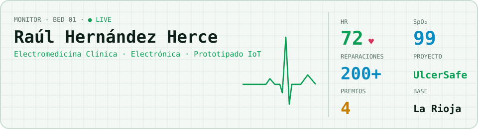
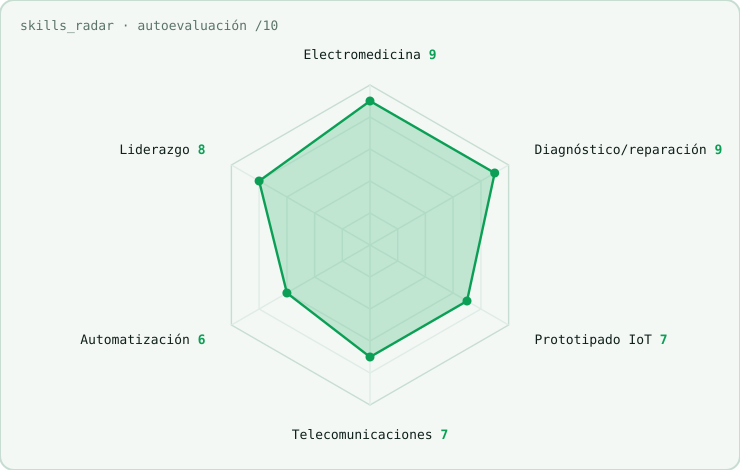

<a href="https://github.com/raulhernandezherce">
  <picture>
    <source media="(prefers-color-scheme: dark)" srcset="banner-dark.svg">
    <source media="(prefers-color-scheme: light)" srcset="banner-light.svg">
    
  </picture>
</a>

 

---

## `$ whoami --vitals`

  <picture>
    <source media="(prefers-color-scheme: dark)" srcset="whoami-dark.svg">
    <source media="(prefers-color-scheme: light)" srcset="whoami-light.svg">
    
  </picture>

## `$ cat tech-stack.yaml`

<table>
  <thead>
    <tr><th colspan="2" align="left"><code>raul:~$ cat tech-stack.yaml</code></th></tr>
  </thead>
  <tbody>
    <tr>
      <td width="50%" valign="top"><code>├─ ⚡ firmware_y_hardware:</code>  
         
        
        
        <code>Sensores</code>
      </td>
      <td width="50%" valign="top"><code>├─ ♥ electromedicina:</code>  
        <code>Mantenimiento correctivo y preventivo</code>&nbsp;
        <code>Diagnóstico de averías electrónicas</code>&nbsp;
        <code>PRL en baja y alta tensión</code>
      </td>
    </tr>
    <tr>
      <td valign="top"><code>├─ ⌨ software_y_web:</code>  
        
      </td>
      <td valign="top"><code>├─ ⚙ automatización_y_diseño:</code>  
        
        <code>FluidSIM</code>
        <code>Telecomunicaciones</code>
      </td>
    </tr>
    <tr>
      <td colspan="2" valign="top"><code>╰─ ⌁ explorando:</code>&nbsp;
        <code>IA embebida (TinyML)</code> <code>agentes con Claude y MCP</code> <code>IoMT</code> <code>wearables médicos</code> <code>teleasistencia</code> <code>marcado CE clase IIa</code> <code>diseño de PCB</code>
      </td>
    </tr>
  </tbody>
  <tfoot>
    <tr><td colspan="2"><code>status: grado_en_curso&nbsp;&nbsp;·&nbsp;&nbsp;environment: hospital + laboratorio</code></td></tr>
  </tfoot>
</table>

---

## `$ cat skills-radar.log`

  <picture>
    <source media="(prefers-color-scheme: dark)" srcset="radar-dark-v2.svg">
    <source media="(prefers-color-scheme: light)" srcset="radar-light-v2.svg">
    
  </picture>

---

## `$ ls ia/ --repos`

<table>
  <tr>
    <td width="33%" valign="top">
      <a href="https://github.com/raulhernandezherce/mcp-electromedicina"><b>⚡ mcp-electromedicina</b></a> 
      Servidor MCP que da a Claude herramientas de ingeniería clínica: seguridad eléctrica IEC 62353, método Fennigkoh-Smith y planificación de preventivos. Protocolo implementado a mano, sin dependencias.  
      <code>MCP</code> <code>JSON-RPC</code> <code>IEC 62353</code>
    </td>
    <td width="33%" valign="top">
      <a href="https://github.com/raulhernandezherce/claude-portero"><b>🚪 claude-portero</b></a> 
      Enrutador de modelos para Claude Code: clasifica cada mensaje en local, con 0 tokens, y manda lo mecánico a Haiku y lo difícil a Opus. ~57 % menos de coste estimado en 819 mensajes reales.  
      <code>Claude Code</code> <code>hooks</code> <code>optimización</code>
    </td>
    <td width="33%" valign="top">
      <a href="https://github.com/raulhernandezherce/electromedicina-skills"><b>🩺 electromedicina-skills</b></a> 
      Plugin de Claude Code con skills de ingeniería clínica: informes de seguridad eléctrica IEC 62353, diagnóstico guiado de averías y fichas de equipos a partir de la placa.  
      <code>Agent Skills</code> <code>plugin</code>
    </td>
  </tr>
  <tr>
    <td width="33%" valign="top">
      <a href="https://github.com/raulhernandezherce/esp32-firmware-skill"><b>🔌 esp32-firmware-skill</b></a> 
      Skill para que los agentes escriban y depuren firmware ESP32/C3, con un analizador de logs serie que explica Guru Meditation, brownouts, watchdogs y bucles de reinicio.  
      <code>ESP32</code> <code>Agent Skills</code>
    </td>
    <td width="33%" valign="top">
      <a href="https://github.com/raulhernandezherce/vj-shaders"><b>🌈 vj-shaders</b></a> · <a href="https://raulhernandezherce.github.io/vj-shaders/">▶ en vivo</a> 
      12 efectos visuales ISF que se ejecutan en el navegador con WebGL, más una skill para que Claude cree shaders nuevos y un validador que detecta errores entre GPUs.  
      <code>GLSL</code> <code>WebGL</code> <code>Agent Skills</code>
    </td>
    <td width="33%" valign="top"></td>
  </tr>
</table>

---

## `$ ls proyectos/ --destacados`

**🎛️ [VJ Studio](https://github.com/raulhernandezherce/vj-studio)** · *Software de VJ y mapeo de vídeo para directo*
> Mesa de VJ completa: matriz de clips, 57 efectos, plugins FFGL y shaders ISF, editor de nodos, varias pantallas con edge blending, DMX por Art-Net, MIDI y OSC. Motor en C++20 y OpenGL, interfaz en Electron y React. [Descargar para macOS](https://github.com/raulhernandezherce/vj-studio/releases/latest).

`C++20` `OpenGL` `Electron` `React` `DMX` `Tiempo real`

 

**🩹 [UlcerSafe](https://github.com/raulhernandezherce/UlcerSafe)** · *Premio Principal VI Premios Sergio Pomar Montahud 2026 (ASELEC)*
> Parche inteligente para ayudar a prevenir las úlceras por presión en personas encamadas. Proyecto en desarrollo.

`Salud digital` `Electromedicina`

 

**🤝 Conecta** · *3.er puesto · Hackathon UR StartupCamp 2026*
> App para combatir la soledad y el aislamiento digital.

`Producto` `Impacto social`

 

**📦 Conect-IN** · *Ganador · III Hackathon de Emprendimiento FP 2025*
> Sistema de organización y trazabilidad para empresas.

`Trazabilidad` `Emprendimiento`

 

**🏪 BarriOS** · *EmprenTech, CEEI Valencia*
> Plataforma con IA para impulsar el comercio local.

`IA` `Comercio local`

 

**⚡ «Motivando a generar energía»** · *Premio Nacional UAITIE de Iniciación a la Investigación Tecnológica 2022 (coautor)*

---

## `$ git log --stats`

---

## `$ connect --contacto`

&nbsp;&nbsp;
<a href="https://raulhernandezherce.framer.website"><b>🌐 raulhernandezherce.framer.website</b></a>

  

<code>// técnica al servicio de las personas ♥</code>

